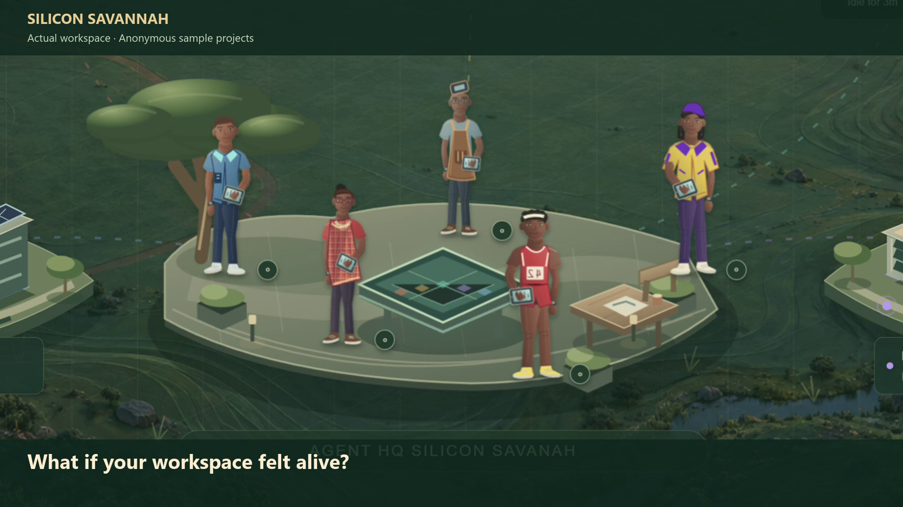

# Silicon Savannah 🇰🇪

**A little Kenyan personality for your AI workspace.**

Projects have buildings. Agents have a place to gather. Click a project, meet its builder, and explore the work in a living savannah.

Built with Codex and Astra. Still an experiment, and open to ideas.



[Watch the 25-second walkthrough](docs/media/silicon-savannah.mp4) · [Setup & local connection](docs/SETUP.md) · [Suggest an idea](../../issues/new?template=idea.yml)

## Try it

Install **Node.js 24 or newer**, then:

```sh
git clone https://github.com/YOUR-USERNAME/silicon-savannah.git
cd silicon-savannah
npm ci
npm run build
npm start
```

Open **http://127.0.0.1:4320**. You start in a self-contained sample workspace; no account, API key or Codex connection is needed.

- **Click a building** to see its agent visit and open its context.
- **Explore HQ** and use the camera controls to get closer.
- **Try task simulation** for explicitly labelled, synthetic task coordination. Start it yourself; it is paused by default.
- **Connect local projects** when you are ready. [Setup guide →](docs/SETUP.md)

## What’s here

A React/SVG scene, ten distinct human builders, project buildings, day/night lighting, agent movement, task context, a local coordination service and an optional Electron desktop window. Keyboard selection and reduced-motion preferences are supported.

This repository contains **Silicon Savannah only**. Your project repositories, conversations, keys and local configuration stay separate.

## What the agents actually do

Walking, gathering and inspecting a building are interface behaviours—not evidence that code is being written. The sample workspace uses invented projects. The task simulation checks synthetic manifests. The optional local connection observes supported Codex history; explicit review actions can start a bounded local Codex review. None of these imply that a reported task has passed independent checks.

Local integrations depend on the installed Codex history schema and currently favour Windows. This is a local app, not a public multi-user service.

## Build with me

Ideas, bug reports and small improvements are welcome. A useful issue includes what you wanted, what happened, and a screenshot using **sample data**. See [CONTRIBUTING.md](CONTRIBUTING.md).

```sh
npm run dev        # Frontend at http://127.0.0.1:5174
npm run typecheck
npm run lint
npm test
```

Run `npm start` in another terminal for backend features while developing.

The characters combine modern field-worker clothing with selected Maasai-inspired design elements. That is the artistic direction of this workspace, not a representation of every Kenyan community.

No open-source license has been selected yet; public visibility alone does not grant redistribution rights. Third-party packages retain their own licenses.
